# VENTRA: Autonomous UAV for GPS-Denied Indoor Exploration and Shaft Inspection

<p align="center">
  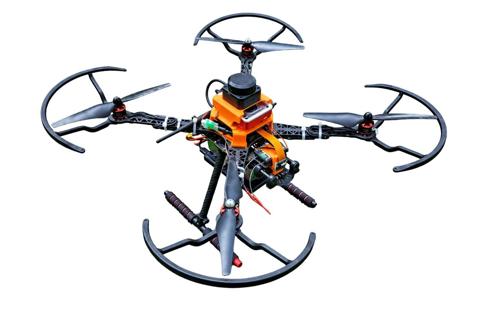
  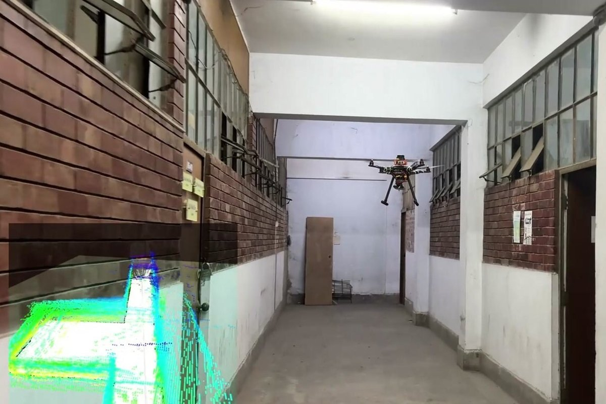
  [](https://www.youtube.com/watch?v=l8zfifEWvgo)
</p>
<p align="center"><em>Figure 1. Left: assembled vehicle with the RPLIDAR C1, 3D-printed mounts and carbon-fibre landing gear. Right: corridor flight with the live 3D reconstruction overlaid.</em></p>

<p align="center">
  
  
  
  
  
</p>

| Item | Detail |
|---|---|
| **Course** | ME 366, Electro-Mechanical System Design and Practice |
| **Group** | B9, Department of Mechanical Engineering, BUET |
| **Date** | October 2026 |
| **Status** | Indoor exploration flight-tested on hardware; shaft inspection validated in PX4 SITL |

---

## 1. Overview

VENTRA is an S500-class quadrotor designed to fly without GNSS in tunnels, mine shafts, wells, warehouses and other enclosed spaces. The system is split across two computers:

- **Flight controller:** Pixhawk 6C running PX4. Responsible for inner-loop control, EKF2 state estimation, failsafes and logging.
- **Companion computer:** Raspberry Pi 5 running ROS 2 Jazzy. Carries a 360° 2D LiDAR and a low-light camera, and runs mapping, localization, planning and the operator interfaces.

The two are connected by PX4's uXRCE-DDS bridge over a serial link.

Early flights relied on optical flow alone for horizontal aiding. Over dim or low-texture floors the flow quality dropped and EKF2 reset its horizontal position. VENTRA addresses this with a LiDAR-anchored localization chain: RF2O scan-matching odometry and SLAM Toolbox produce a map-frame pose, which is returned to EKF2 as an external-vision measurement. Nav2 (A* planner), a custom frontier explorer, a braking-limited reactive-avoidance filter and stacked-section 3D mapping run on top of this chain. A separate SLAM-free mode handles vertical shaft inspection.

---

## 2. Key Capabilities

| Capability | Implementation and result |
|---|---|
| GPS-free hover | 283 s logged indoor flight; altitude held at 1.15 m (σ = 0.07 m); roll and pitch within ±5° |
| LiDAR-anchored pose | RF2O + SLAM Toolbox pose fused by EKF2 as external vision at 10 Hz; removes the position resets seen over featureless floors |
| 2D and 3D mapping | 5 cm occupancy grid in real time; each scan placed at PX4's measured height and attitude in a 10 cm voxel map |
| Autonomous exploration | Frontier explorer selects goals; Nav2 (A*) plans and follows the path |
| Reactive avoidance | Every velocity command is limited to a speed from which the vehicle can still stop, and is steered to slide along walls rather than stop at them |
| Shaft inspection | Bore centre measured in every scan and fused as an absolute horizontal fix; 24.8 m autonomous descent and return in PX4 SITL with no wall contact |
| Ground-control software | Browser-based process launcher, web teleoperation dashboard with MJPEG video, read-only shaft mission dashboard |

---

## 3. System Architecture

The design separates time-critical flight control from computationally heavy autonomy. The Pixhawk 6C keeps the vehicle stable even if the companion computer stalls. The Raspberry Pi 5 runs perception, SLAM, pose fusion and autonomy in ROS 2. The uXRCE-DDS link (orange in Figure 2) carries PX4 odometry out of the flight controller and carries external-vision poses and Offboard setpoints in. The physical link is `/dev/ttyAMA0` on the Pi to TELEM2 on the Pixhawk at 921 600 baud.

<p align="center">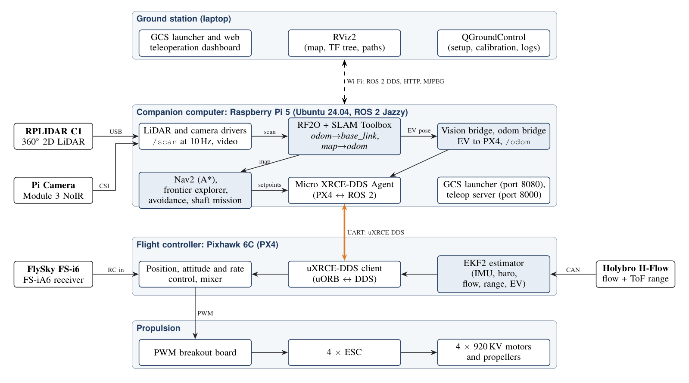</p>
<p align="center"><em>Figure 2. System architecture.</em></p>

### 3.1 Localization and autonomy pipeline

RF2O and SLAM Toolbox anchor the pose to the map, and the vision bridge returns it to EKF2 as external vision (thick orange arrow in Figure 3). The map feeds Nav2 and the frontier explorer. Every velocity command passes through the reactive-avoidance filter before the Offboard bridge forwards it to PX4.

<p align="center">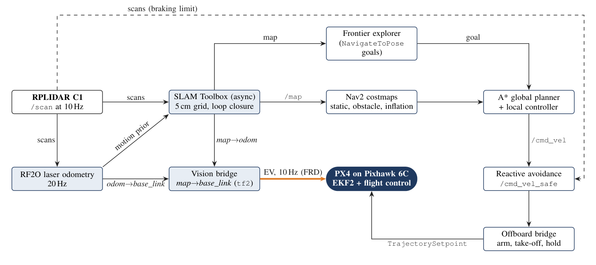</p>
<p align="center"><em>Figure 3. Localization and autonomy pipeline.</em></p>

### 3.2 Coordinate frames (REP 105)

<p align="center">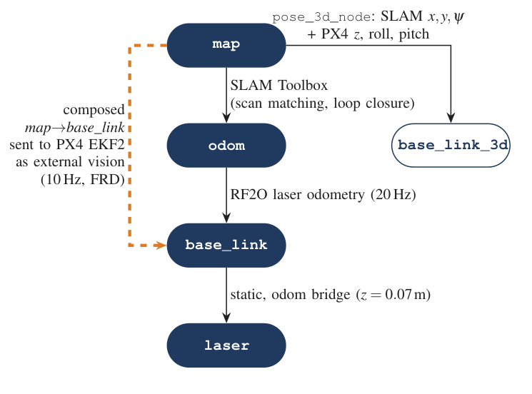</p>
<p align="center"><em>Figure 4. TF tree.</em></p>

Each TF edge has exactly one publisher. Two publishers on the same edge corrupt the tree.

| Edge | Publisher |
|---|---|
| `map → odom` | SLAM Toolbox |
| `odom → base_link` | RF2O (odometry topic remapped to `/odom_rf2o`) |
| `base_link → laser` | `odom_bridge_node` (static, z = 0.07 m) |
| `map → base_link_3d` | `pose_3d_node`: SLAM x, y, yaw combined with PX4 z, roll, pitch; used only for 3D mapping |

PX4 uses NED/FRD and ROS uses ENU/FLU; the bridge nodes convert in both directions. Because the SLAM map has no north reference, the external-vision pose is declared in PX4's heading-locked FRD frame.

---

## 4. Operating Modes

<p align="center">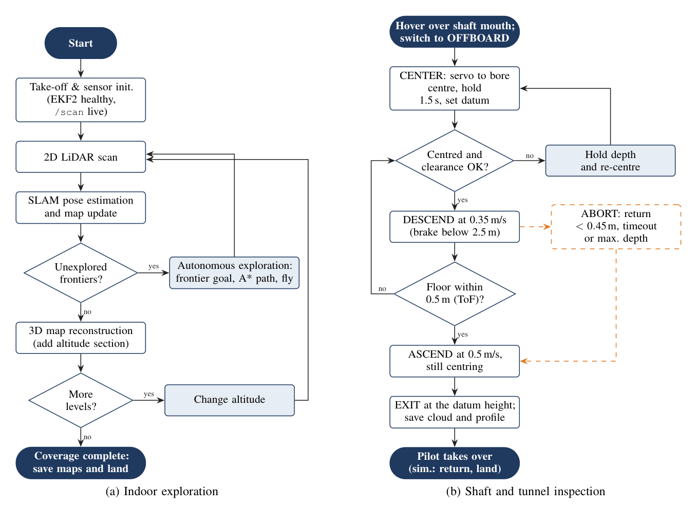</p>
<p align="center"><em>Figure 5. Mission logic: (a) indoor exploration with Nav2 and the frontier explorer; (b) shaft-inspection state machine. The dashed path is the abort branch.</em></p>

### 4.1 Indoor exploration

1. Take off and wait for sensor initialization (EKF2 healthy, `/scan` publishing).
2. SLAM Toolbox builds a 2D occupancy map from the LiDAR scans.
3. The frontier explorer selects a goal on the boundary between known free space and unknown space. Nav2 plans an A* path to it and the vehicle follows the path with reactive avoidance active.
4. Exploration at that altitude ends when no reachable frontiers remain. Repeating at other altitudes adds horizontal sections to the 3D reconstruction.

<table>
  <tr>
    <td width="50%">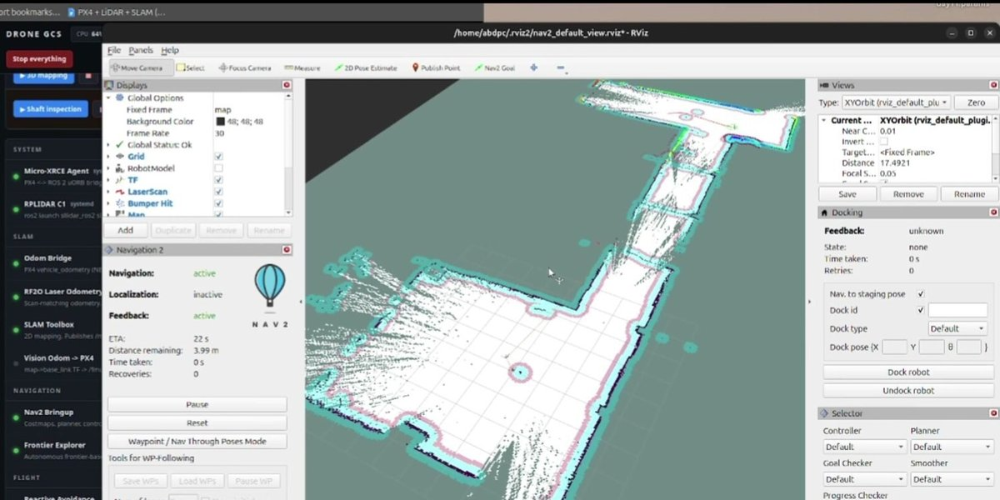</td>
    <td width="50%">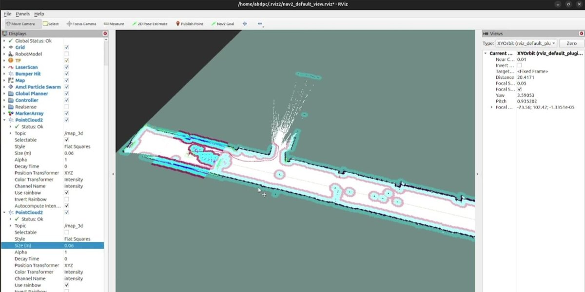</td>
  </tr>
  <tr>
    <td align="center"><em>GCS launcher beside RViz2 with the Nav2 panel and a planned path</em></td>
    <td align="center"><em>Frontier exploration of a corridor map</em></td>
  </tr>
  <tr>
    <td>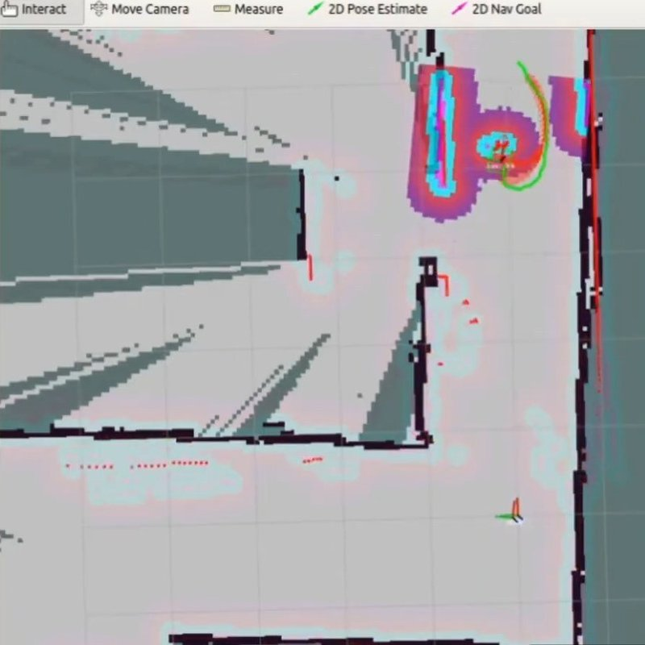</td>
    <td>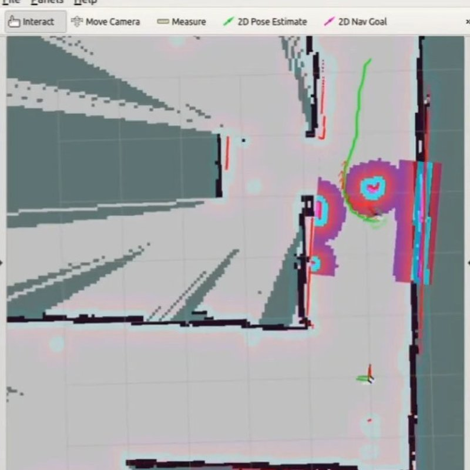</td>
  </tr>
  <tr>
    <td align="center"><em>New obstacle detected near the planned path</em></td>
    <td align="center"><em>Nav2 re-plans around the obstacle</em></td>
  </tr>
  <tr>
    <td>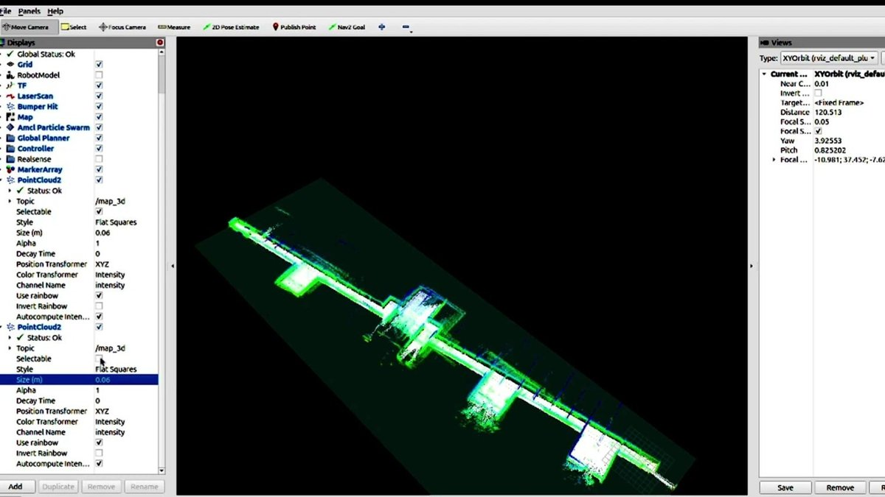</td>
    <td>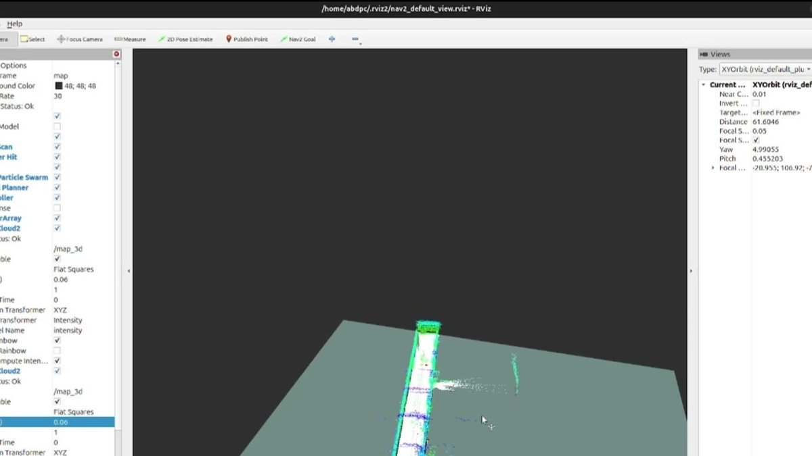</td>
  </tr>
  <tr>
    <td align="center"><em>Stacked LiDAR sections forming a corridor point cloud</em></td>
    <td align="center"><em>Resulting 3D model in RViz2</em></td>
  </tr>
</table>

### 4.2 Shaft and tunnel inspection (`shaft_inspection`)

A vertical bore provides almost no geometric constraint along its own axis, so scan-matching SLAM is not usable. This mode uses no SLAM:

| Quantity | Source |
|---|---|
| Horizontal position | Bore centre (point of maximum clearance, found with a Euclidean distance transform) from every scan, fused by EKF2 as external vision |
| Depth | EKF2 height, barometer as the height reference |
| Distance to floor | Downward ToF rangefinder |
| Wall avoidance | Centring, repulsion and a velocity clamp, all derived from the LiDAR |
| 3D map | Scans stacked at known depth, one slice per 5 cm |

Mission sequence: hover over the shaft mouth, switch to Offboard, centre and record the depth datum, descend at 0.35 m/s while centred, brake from 2.5 m above the floor and turn around 0.5 m above it, climb at 0.5 m/s, stop at the datum height and return control to the pilot. Outputs are a point cloud (`.pcd`) and a radius-versus-depth profile (`.csv`).

<p align="center">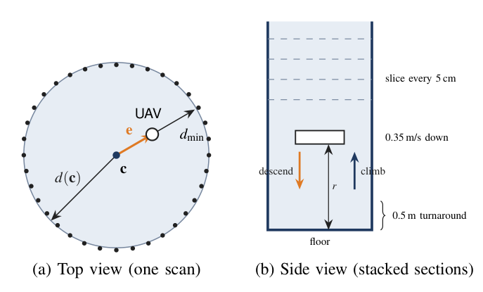</p>
<p align="center"><em>Figure 6. (a) From the wall points of each scan, the vehicle finds the point of maximum clearance <b>c</b> (the bore centre); the offset <b>e</b> drives the centring controller. (b) The vehicle descends while centred, records a section every 5 cm and turns around 0.5 m above the floor.</em></p>

<table>
  <tr>
    <td width="50%">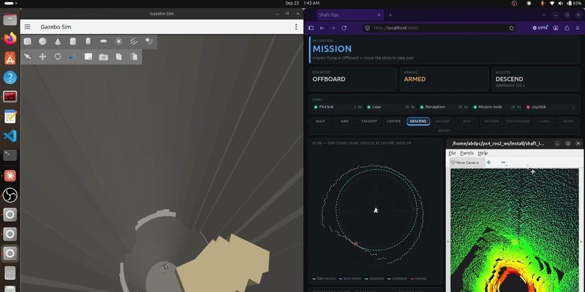</td>
    <td width="50%">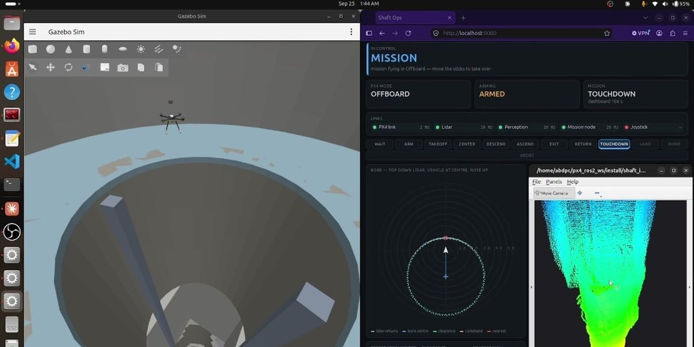</td>
  </tr>
  <tr>
    <td align="center"><em>Simulated descent with the dashboard and the growing 3D map</em></td>
    <td align="center"><em>Completed 3D reconstruction and shaft profile</em></td>
  </tr>
</table>

Design details are in [`src/shaft_inspection/README.md`](src/shaft_inspection/README.md). The hardware build and test procedure is in [`src/shaft_inspection/docs/HARDWARE_GUIDE.md`](src/shaft_inspection/docs/HARDWARE_GUIDE.md).

---

## 5. Hardware

| Component | Specification | Function |
|---|---|---|
| S500-class X frame | Carbon-fibre landing legs, propeller guards | Structure; protection in confined spaces |
| 4 × DJI 920 KV motors with ESCs | 4S Li-Po (14.8 V nominal), 20–22 A in hover | Propulsion |
| Pixhawk 6C | STM32H743, dual IMU, MS5611 barometer; PX4 | Control, EKF2 estimation, logging |
| Holybro H-Flow | PAA3905 optical flow + AFBR-S50 ToF, DroneCAN | GPS-free velocity, distance to floor |
| RPLIDAR C1 | 360° DTOF, 0.05–12 m, 10 Hz, 0.72° resolution | SLAM, obstacle detection, 3D reconstruction |
| Raspberry Pi 5 (8 GB) | Ubuntu 24.04, ROS 2 Jazzy | Companion computer |
| Pi Camera Module 3 NoIR | 12 MP IMX708, no IR-cut filter | Low-light operator video |
| FlySky FS-i6 + FS-iA6 | 2.4 GHz, 6 channels | Manual flight and safety override |
| 3DR telemetry radios | MAVLink | Link to QGroundControl |
| USB power bank | 5 V | Independent supply for the Pi, LiDAR and camera |
| 3D-printed mounts | PLA, 20–30 % infill, filleted and gusseted, rubber standoffs | Hold the LiDAR, Pi and camera; keep the CoG central |

Recorded procurement cost: approximately **139 590 BDT**.

<table>
  <tr>
    <td width="33%">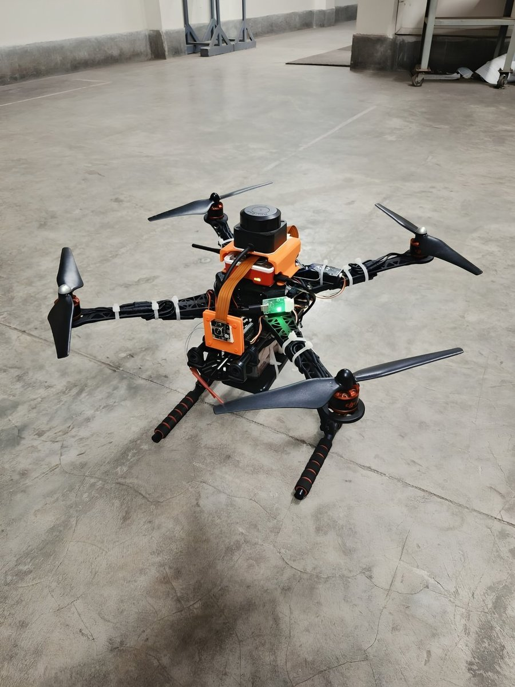</td>
    <td width="33%">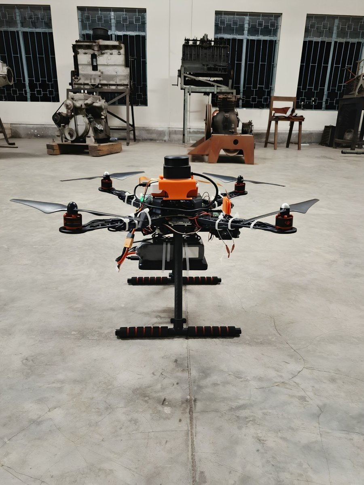</td>
    <td width="33%">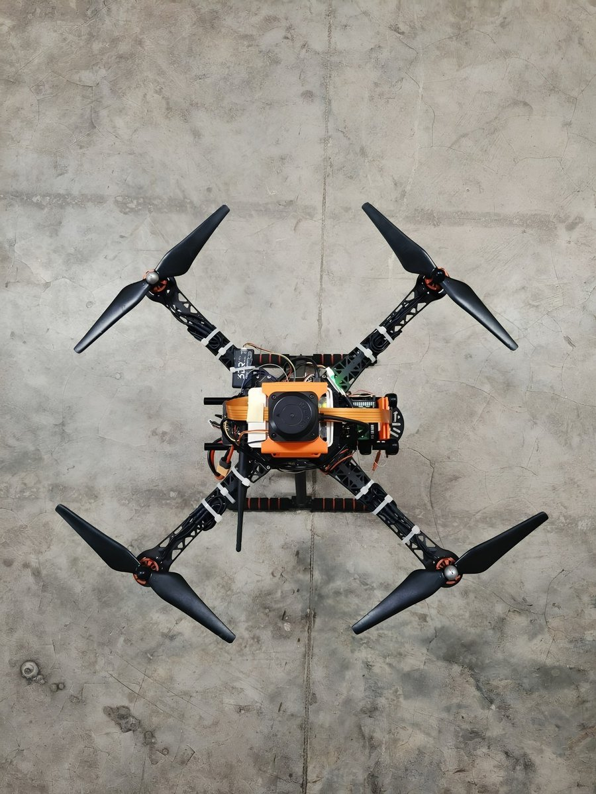</td>
  </tr>
  <tr>
    <td align="center"><em>Three-quarter view</em></td>
    <td align="center"><em>Front view</em></td>
    <td align="center"><em>Top view: X layout and central mount stack</em></td>
  </tr>
  <tr>
    <td>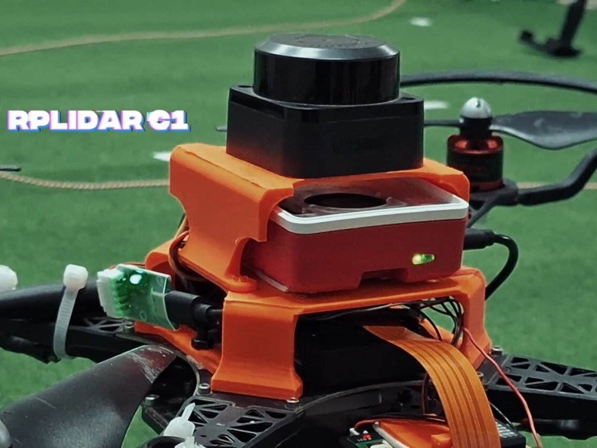</td>
    <td>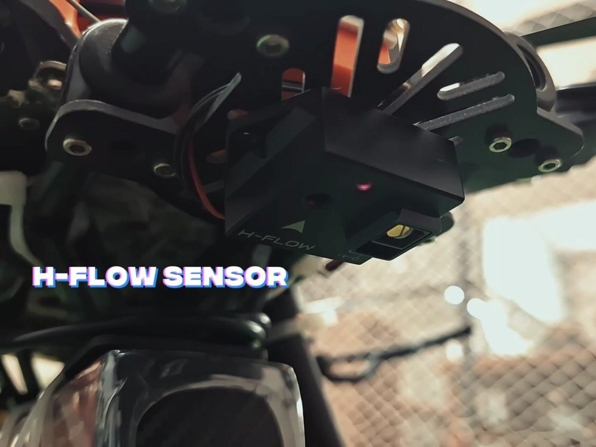</td>
    <td>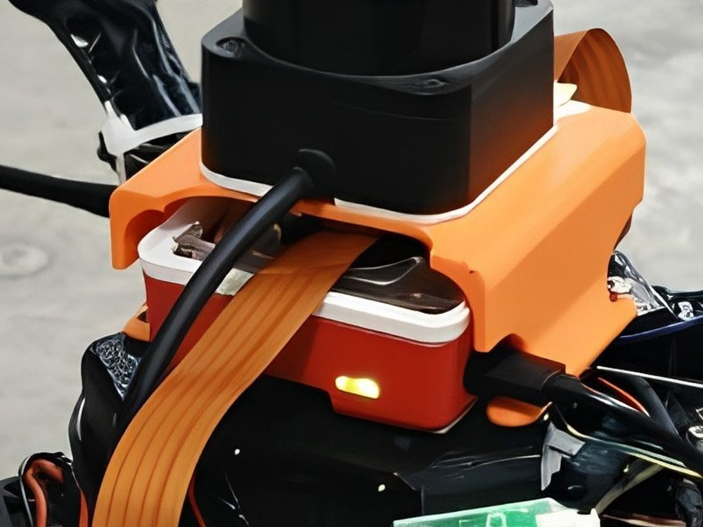</td>
  </tr>
  <tr>
    <td align="center"><em>RPLIDAR C1 on its raised mount</em></td>
    <td align="center"><em>Holybro H-Flow under the body</em></td>
    <td align="center"><em>Redesigned PLA mount above the Pi 5</em></td>
  </tr>
  <tr>
    <td>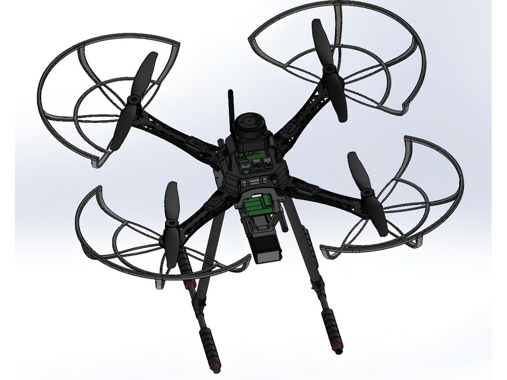</td>
    <td>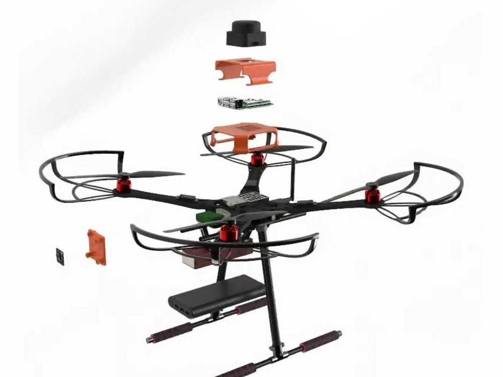</td>
    <td>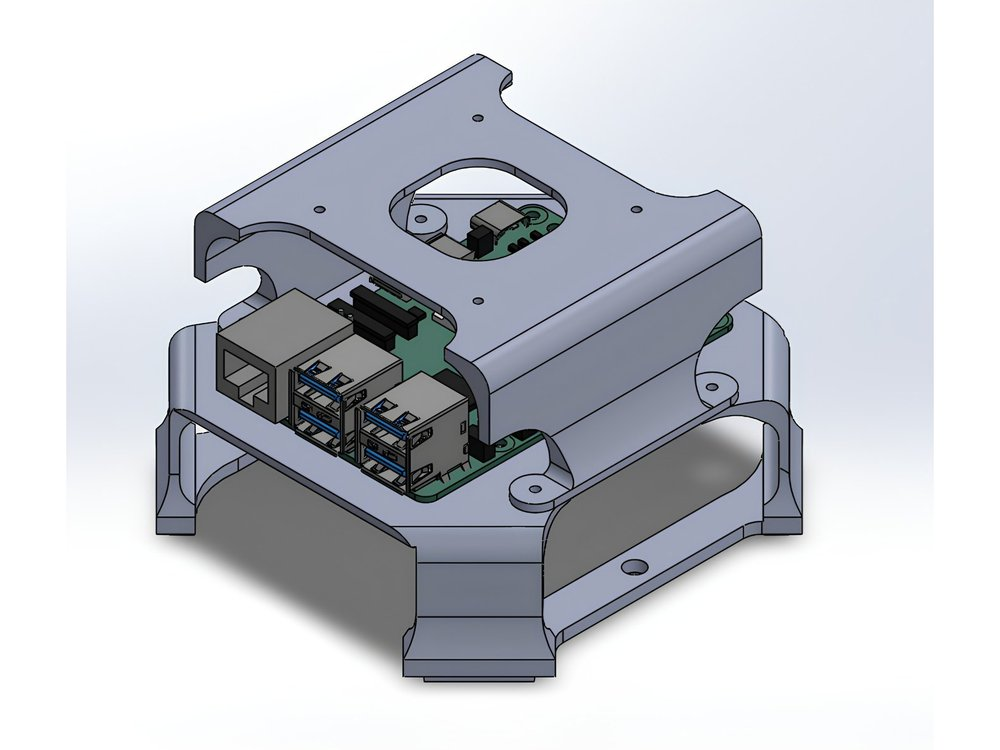</td>
  </tr>
  <tr>
    <td align="center"><em>CAD model with propeller guards</em></td>
    <td align="center"><em>Exploded view of the mount stack</em></td>
    <td align="center"><em>Ventilated housing with the Pi 5 installed</em></td>
  </tr>
</table>

### 5.1 Power distribution and wiring

The flight domain and the compute domain have independent power supplies. The only connection between them is the TELEM2 to UART link, which carries TX, RX and ground. The Pixhawk 5 V rail is not connected to the Pi.

<p align="center">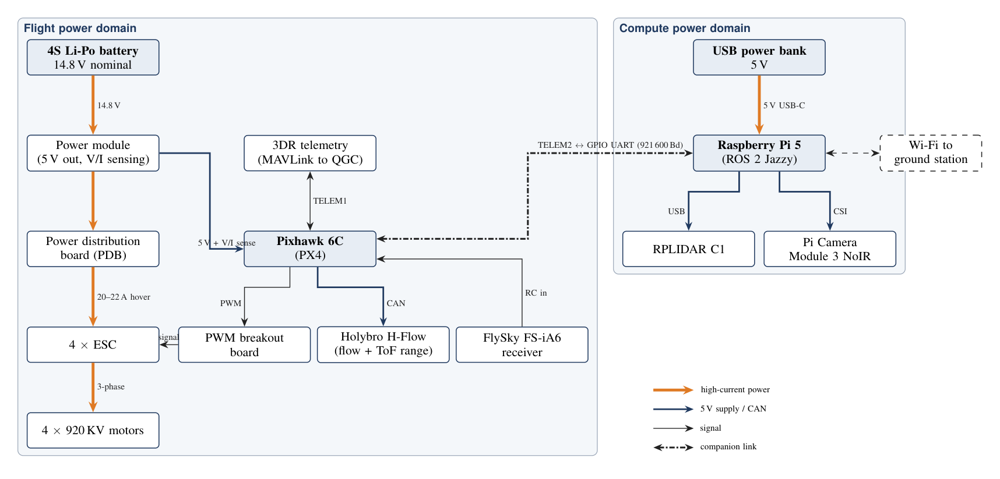</p>
<p align="center"><em>Figure 7. Power distribution and wiring. Flight domain on the left, compute domain on the right.</em></p>

---

## 6. Repository Layout

```
.
├── drone_gcs.py                 Browser-based ground-control launcher (port 8080)
├── web_teleop.py                Web teleoperation dashboard: MJPEG video, joystick, D-pad, keys (port 8000)
├── TECHNICAL_HANDBOOK.md        Workspace technical handbook (interfaces, configuration, procedures)
├── docs/images/                 Photographs, diagrams and plots used in this document
├── run_cmds/
│   ├── slam.sh                  Starts the LiDAR-anchored localization chain in order
│   └── drone3d.rviz             RViz2 configuration for 2D and 3D mapping
├── scripts/
│   ├── visualize.py             PX4 odometry to ROS bridge for Gazebo SITL (sim time)
│   └── real_visualize.py        Same, for hardware (system clock)
├── obstacle_avoidance/          Standalone MAVSDK + RPLIDAR front-obstacle back-off test
├── slam_params.yaml             SLAM Toolbox parameters
├── shaft_real.yaml              shaft_inspection parameters for the physical vehicle
├── px4_offboard_updated.zip     Revised cmd_vel to Offboard controller and keyboard teleop
└── src/                         colcon workspace
    ├── odom_bridge/             Localization, exploration, avoidance and 3D mapping nodes
    │   ├── odom_bridge/
    │   │   ├── odom_bridge_node.py      PX4 NED/FRD odometry to /odom (ENU/FLU), static laser TF
    │   │   ├── vision_odom_bridge.py    map → base_link to /fmu/in/vehicle_visual_odometry
    │   │   ├── pose_3d_node.py          base_link_3d frame (SLAM x, y, ψ + PX4 z, φ, θ)
    │   │   ├── scan_3d_mapper.py        10 cm voxel map on /map_3d, saved as .ply
    │   │   ├── frontier_explorer.py     Frontier detection, Nav2 NavigateToPose goals
    │   │   └── reactive_avoidance.py    Braking-limited, wall-sliding velocity filter
    │   ├── launch/full_stack_launch.py  Staggered bring-up of the chain (simulation)
    │   └── config/slam_toolbox_params.yaml
    ├── shaft_inspection/        SLAM-free shaft mission, perception, mapper and dashboard
    ├── ROS2-PX4_Drone_Teleoperation_Using_Joystick/  PX4 SITL with keyboard/joystick Offboard control
    ├── rf2o_laser_odometry/     RF2O scan-matching odometry (third party)
    ├── px4_msgs/                PX4 message definitions (third party)
    └── px4_ros_com/             PX4 to ROS 2 examples and frame helpers (third party)
```

---

## 7. Getting Started

### 7.1 Prerequisites

- Raspberry Pi 5 with Ubuntu 24.04 and ROS 2 Jazzy
- Pixhawk 6C with PX4, calibrated in QGroundControl
- [Micro XRCE-DDS Agent](https://docs.px4.io/main/en/middleware/uxrce_dds.html)
- [`sllidar_ros2`](https://github.com/Slamtec/sllidar_ros2) for the RPLIDAR C1
- Python packages for the ground-control tools: `fastapi`, `uvicorn`, `psutil`, `pillow`

### 7.2 Build

```bash
sudo apt install ros-jazzy-slam-toolbox ros-jazzy-navigation2 ros-jazzy-nav2-bringup
git clone https://github.com/WakifRajin/VENTRA.git ~/px4_ros2_ws
cd ~/px4_ros2_ws && colcon build
source install/setup.bash
```

### 7.3 Configuration

Several paths are fixed in the scripts and must be set for the target machine before first use:

| File | Setting | Purpose |
|---|---|---|
| `drone_gcs.py` | `HOME` (top of file) | Root for every path the launcher uses |
| `run_cmds/slam.sh` | `slam_params_file:=` path | SLAM Toolbox parameter file |
| `shaft_real.yaml` | `shaft_mapper.out_dir` | Output directory for shaft maps |

The launcher also expects the following files in `$HOME`. They are not part of this repository:

| File | Used by |
|---|---|
| `nav2_params.yaml` | Nav2 bring-up |
| `cmd_vel_teleop_v2.py` | Offboard control node (Flight group) |
| `laserscan_to_obstacle_distance.py` | PX4 obstacle-distance bridge (Flight group) |
| `web_teleop.py` | Web teleoperation; copy from the repository root |

The XRCE agent and the LiDAR driver are managed as systemd services named `micro-xrce-agent.service` and `sllidar.service`.

### 7.4 Bring-up on the vehicle

```bash
# PX4 bridge and LiDAR driver (normally started by systemd)
MicroXRCEAgent serial --dev /dev/ttyAMA0 -b 921600
ros2 launch sllidar_ros2 sllidar_c1_launch.py

# LiDAR-anchored localization chain
bash ~/px4_ros2_ws/run_cmds/slam.sh

# All remaining nodes from a browser at http://<pi-ip>:8080
python3 ~/px4_ros2_ws/drone_gcs.py
```

`full_stack_launch.py` starts the same chain with `use_sim_time: true` and is intended for simulation only. On hardware, use `slam.sh` or the GCS launcher.

| Service | Port |
|---|---|
| GCS launcher (`drone_gcs.py`) | 8080 |
| Web teleoperation (`web_teleop.py`) | 8000 |
| Shaft dashboard, on the vehicle (`shaft_real.yaml`) | 8081 |
| Shaft dashboard, in simulation (`shaft_bringup.launch.py`) | 8080 |

The launcher prevents two node pairs from running together, because each pair writes to the same PX4 input topic: `shaft_perception` and `vision_odom_bridge` (`/fmu/in/vehicle_visual_odometry`), and `shaft_mission` and the Offboard control node (`/fmu/in/trajectory_setpoint`).

### 7.5 Simulation

- **Teleoperation and Offboard development:** PX4 SITL, Gazebo and the XRCE-DDS agent. See [`src/ROS2-PX4_Drone_Teleoperation_Using_Joystick`](src/ROS2-PX4_Drone_Teleoperation_Using_Joystick/README.md).
- **Shaft mission:** PX4 SITL with the `x500_shaft` model (airframe 4023) in the `vshaft` world. See [`src/shaft_inspection/README.md`](src/shaft_inspection/README.md) §6 and [`run_cmds/shaft_sim.sh`](src/shaft_inspection/run_cmds/shaft_sim.sh).

---

## 8. PX4 Configuration for GPS-Denied Flight

| Parameter | Value | Purpose |
|---|---|---|
| `EKF2_GPS_CTRL`, `SYS_HAS_GPS` | 0, 0 | Disable GPS aiding and GPS checks |
| `COM_ARM_WO_GPS` | 1 | Allow arming without GPS |
| `UAVCAN_ENABLE` | 2 | Enable DroneCAN sensors (H-Flow) |
| `EKF2_OF_CTRL` | 1 | Fuse optical flow |
| `EKF2_HGT_REF`, `EKF2_BARO_CTRL` | 0, 1 | Barometer as the height reference |
| `EKF2_RNG_CTRL` | 1 | Rangefinder aids height only when low (< 3 m) and slow (< 1 m/s) |
| `EKF2_EV_CTRL` | 9 (HPOS + yaw) indoors; 1 (HPOS only) in shafts | External-vision fusion |
| `EKF2_EV_DELAY` | ≈ 50 ms, tuned from logs | Scan and processing latency |
| `MPC_XY_VEL_MAX` | 1.0 m/s | Confined-space speed limit |
| `MPC_TILTMAX_AIR` | 20° | Limits tilt and therefore scan-plane tilt |
| `COM_RC_OVERRIDE` | 3 | Stick input overrides Auto and Offboard modes |

The complete shaft parameter set is in [`px4_v1.14_shaft.params`](src/shaft_inspection/deploy/px4_v1.14_shaft.params), with per-parameter notes in [`px4_v1.14_shaft_params_explained.txt`](src/shaft_inspection/deploy/px4_v1.14_shaft_params_explained.txt). External-vision setup for the indoor stack is described in [`src/odom_bridge/README.md`](src/odom_bridge/README.md).

---

## 9. Results

| Quantity | Value |
|---|---|
| Logged flight duration | 283 s, indoor, no GPS |
| Altitude hold | Mean 1.15 m, σ = 0.07 m |
| Roll and pitch in steady hover | Within ±5° |
| Hover current and power | 20–22 A, 270–300 W |
| Battery internal resistance | ≈ 0.11 Ω |
| Dominant vibration | 105–111 Hz rotor band, no growth over the flight |
| Shaft mission (SITL) | 24.8 m autonomous descent and return, no wall contact |
| Bore-centre estimator | 1–5 cm agreement on circular, rectangular, elliptical, D-shaped and rough sections; ≈ 3 ms per scan |

### 9.1 Flight-log analysis (283 s GPS-free flight)

<table>
  <tr>
    <td width="50%">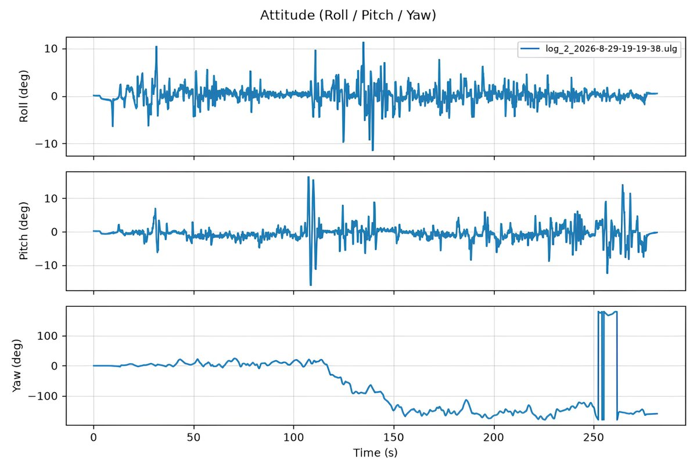</td>
    <td width="50%">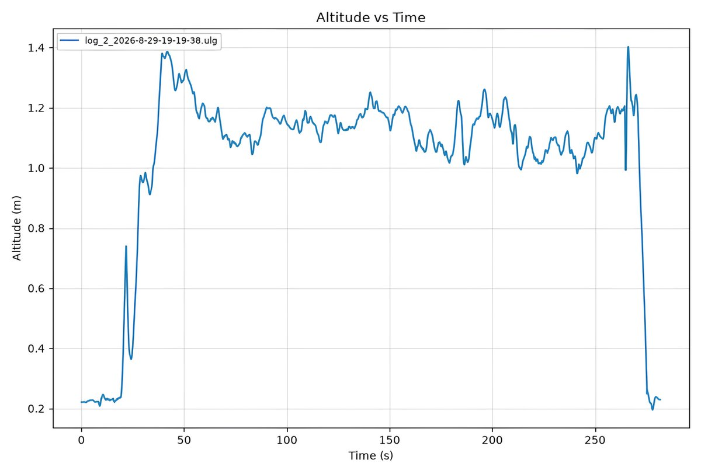</td>
  </tr>
  <tr>
    <td align="center"><em>Roll, pitch and yaw</em></td>
    <td align="center"><em>Altitude: 1.15 m hold, σ = 0.07 m</em></td>
  </tr>
  <tr>
    <td>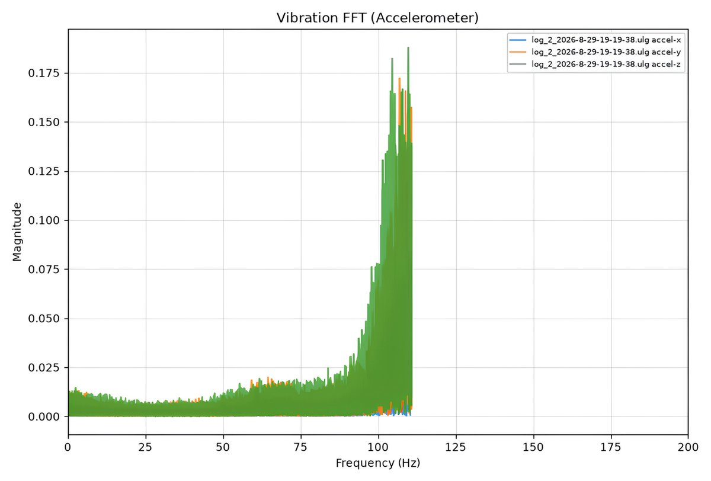</td>
    <td>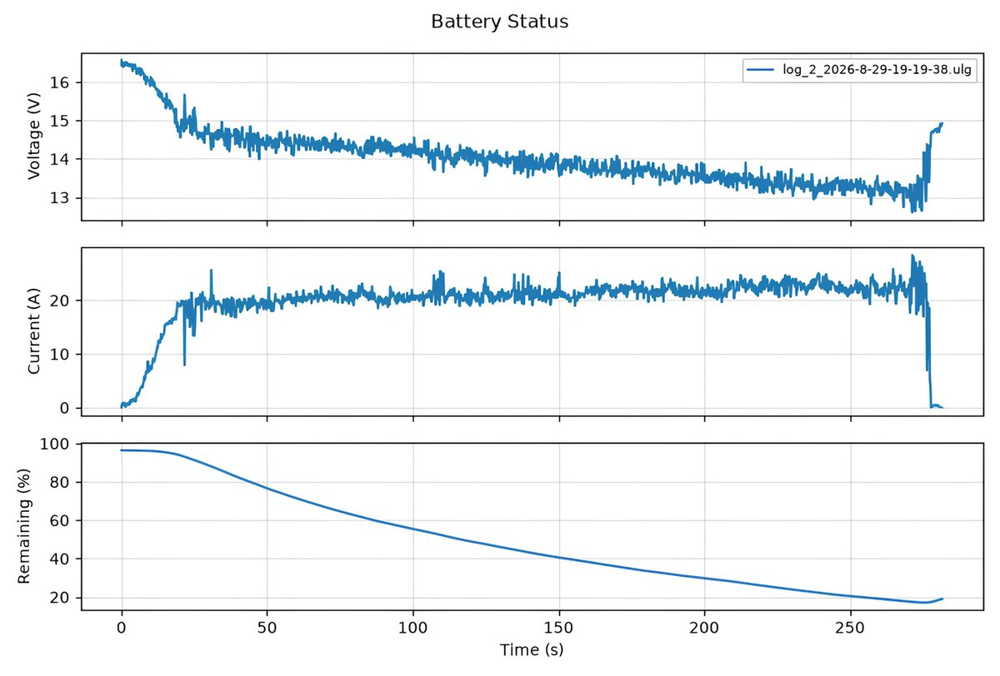</td>
  </tr>
  <tr>
    <td align="center"><em>Accelerometer FFT: energy confined to the 105–111 Hz rotor band</em></td>
    <td align="center"><em>Battery voltage, current and remaining charge</em></td>
  </tr>
</table>

### 9.2 Mapping

<table>
  <tr>
    <td width="50%">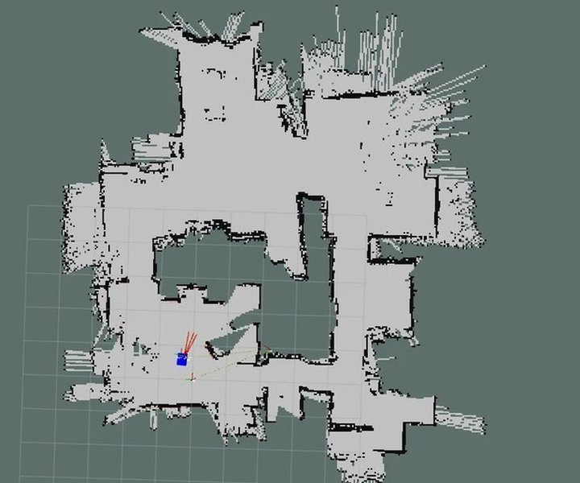</td>
    <td width="50%">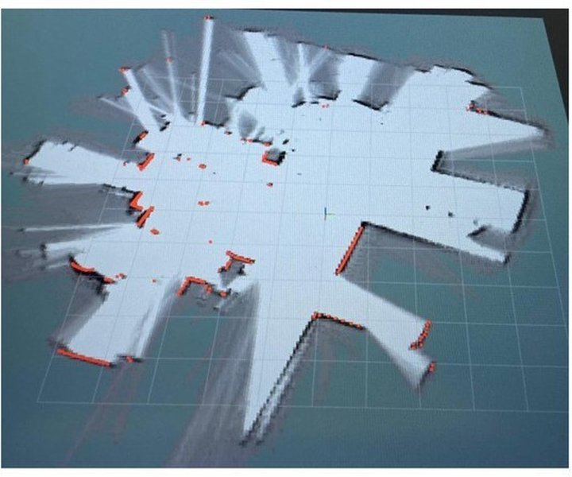</td>
  </tr>
  <tr>
    <td align="center"><em>Occupancy map of a multi-room area</em></td>
    <td align="center"><em>Perspective view of a mapped area</em></td>
  </tr>
</table>

### 9.3 Ground-control software

<table>
  <tr>
    <td width="33%">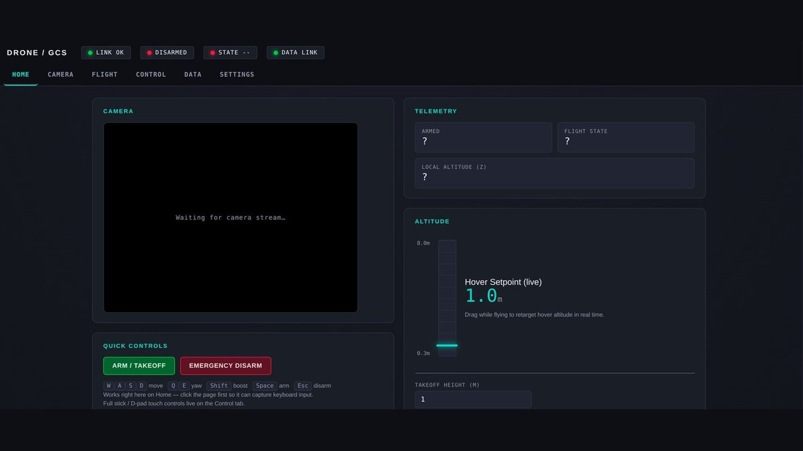</td>
    <td width="33%">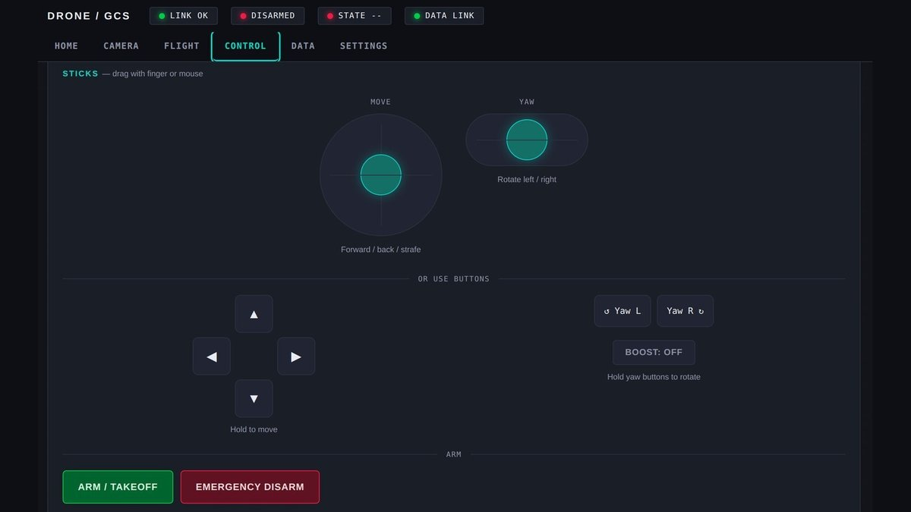</td>
    <td width="33%">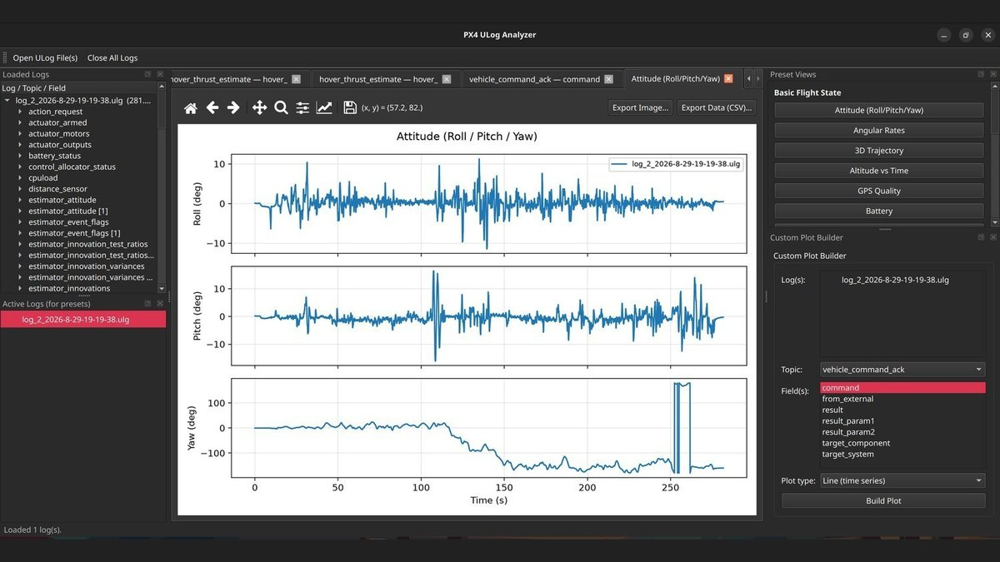</td>
  </tr>
  <tr>
    <td align="center"><em>Web teleoperation: video, arming and emergency controls</em></td>
    <td align="center"><em>Virtual joystick and D-pad</em></td>
    <td align="center"><em>PX4 flight-log workbench</em></td>
  </tr>
</table>

---

## 10. Scope and Limitations

- Indoor exploration, mapping and 3D reconstruction were demonstrated on the physical vehicle. The shaft mission has been validated in PX4 SITL only.
- The RPLIDAR C1 is a 2D sensor. Obstacles above or below the scan plane, glass and specular surfaces may not be detected.
- Map and pose accuracy have not been measured against ground truth (for example, motion capture).
- Flight endurance is approximately 5 minutes. Replacing the power bank with a regulator fed from the flight battery would reduce mass and extend it.
- All flights were conducted with a safety pilot holding an RC transmitter. Perform initial tests with the propellers removed.

---

## 11. Documentation

| Document | Content |
|---|---|
| [`TECHNICAL_HANDBOOK.md`](TECHNICAL_HANDBOOK.md) | Workspace structure, interfaces, configuration and operating procedures |
| [`src/odom_bridge/README.md`](src/odom_bridge/README.md) | LiDAR-anchored localization chain and EKF2 external-vision setup |
| [`src/shaft_inspection/README.md`](src/shaft_inspection/README.md) | Shaft-inspection design, simulation and parameter reference |
| [`src/shaft_inspection/docs/HARDWARE_GUIDE.md`](src/shaft_inspection/docs/HARDWARE_GUIDE.md) | Hardware build, bench tests and staged flight testing for the shaft mission |
| [`obstacle_avoidance/readme.md`](obstacle_avoidance/readme.md) | Standalone front-obstacle back-off test |
| [`src/ROS2-PX4_Drone_Teleoperation_Using_Joystick/README.md`](src/ROS2-PX4_Drone_Teleoperation_Using_Joystick/README.md) | SITL teleoperation environment |

---

## 12. Team

**Group B9, Department of Mechanical Engineering, BUET**

| Name | Student ID |
|---|---|
| Abul Hasnat Abdullah | 2210061 |
| Azwad Wakif Rajin | 2210089 |
| Ahnaf Chowdhury | 2210093 |

**Supervisors:** Dr. Kazi Arafat Rahman, Md. Moyeenul Hossain Ratul, Rafiul Haq, Kazi Tawseef Rahman

## 13. Acknowledgements

This work builds on [PX4 Autopilot](https://px4.io), [ROS 2](https://docs.ros.org/en/jazzy/), [SLAM Toolbox](https://github.com/SteveMacenski/slam_toolbox), [Nav2](https://nav2.org), [RF2O laser odometry](https://github.com/MAPIRlab/rf2o_laser_odometry) and [sllidar_ros2](https://github.com/Slamtec/sllidar_ros2). Third-party packages under `src/` retain their original licences.
